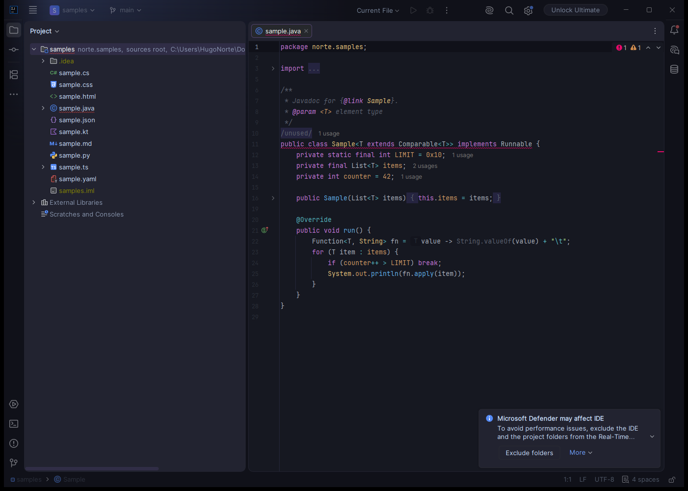
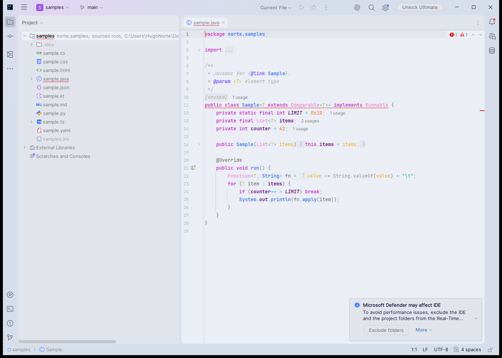

# Norte

A color theme for IntelliJ Platform IDEs (IntelliJ IDEA, WebStorm, PyCharm, PhpStorm, Rider, GoLand and others): a deep indigo workbench with vivid, balanced syntax colors.

## Variants

| Variant | Description |
|---|---|
| **Norte** | Dark indigo UI, One Dark style syntax colors |
| **Norte Bright** | Same UI, more saturated syntax colors |
| **Norte Italic** | Norte with italics for comments, HTML attributes, `extends`, built-in constants and more |
| **Norte Bright Italic** | Norte Bright with the same italics |
| **Norte Light** | Light UI and syntax |

Each variant is a UI theme plus its own editor color scheme; choosing the theme applies the scheme.

## Screenshots

See [`docs/screenshots/`](docs/screenshots/) (`<variant>-<language>.png`, taken in IntelliJ IDEA 2026.2 with the Islands UI).




## Installation

**From disk:** download `norte-<version>.zip` (or build it, see below), then in the IDE open
**Settings → Plugins → ⚙ → Install Plugin from Disk…**, choose the zip and restart if asked.
Then pick the variant in **Settings → Appearance & Behavior → Appearance → Theme**.

Requires an IntelliJ Platform IDE 2025.3 or newer (build 253+), the release that introduced the Islands UI the themes extend.

## How it is built

The themes are **generated**: the files in `src/main/resources/themes/` come from a converter that reads VS Code color theme files (JSON) and writes IntelliJ files. Never edit the generated files by hand; change the mappings or the overrides and regenerate.

```
<VS Code theme JSON files>  (outside this repository)
        │  + converter/sources.local.json   (variant → file; git-ignored)
        ▼
converter (Node.js, no dependencies)
        │  + converter/mappings/*.json      (VS Code keys → IntelliJ keys)
        │  + converter/overrides/*.json     (adjustments, each one justified in _notes)
        ▼
src/main/resources/themes/NRT*.theme.json + NRT*.xml   (committed)
        ▼
./gradlew buildPlugin → build/distributions/norte-<version>.zip
```

### Regenerate the themes

Requirements: Node.js 18+ and JDK 21+ (Gradle downloads the IDE; the sandbox runs on its bundled runtime).

1. Copy `converter/sources.example.json` to `converter/sources.local.json` and fill in `sourceDir` (the folder with the VS Code theme JSON files) and the file of each variant. The directory can also come from `--source <dir>` or the `NRT_SOURCE_DIR` environment variable (in that order of precedence).
2. Run:

```bash
cd converter
npm test            # unit, determinism and snapshot tests
npm run build       # writes src/main/resources/themes/ and the themeProvider block of plugin.xml
cd ..
./gradlew buildPlugin verifyPlugin
```

`node src/index.js --out <dir> --verbose` prints, per variant, the rule that won for each IntelliJ key, the rules that never won, and the keys still colored by the parent scheme. After an intentional change, refresh the snapshots with `npm run snapshots:update`.

### Converter layout

| Path | Purpose |
|---|---|
| `converter/variants.config.json` | The 5 variants: id, display name, dark/light, parent scheme, parent theme and a **fixed UUID** (never change it, users would lose their selected theme) |
| `converter/mappings/ui-map.json` | VS Code workbench color → IntelliJ UI keys |
| `converter/mappings/ui-derived.json` | IntelliJ UI keys without a VS Code counterpart, as expressions over the palette |
| `converter/mappings/editor-colors-map.json` | VS Code workbench colors → editor scheme colors and attributes (search, braces, console…) |
| `converter/mappings/syntax-map.json` | IntelliJ attribute key → representative TextMate scope stack |
| `converter/overrides/` | Adjustments for all variants (`_all.json`) or one variant (`<id>.json`); each needs a reason in `_notes` |
| `converter/reference/` | Key names known by the IDE, extracted with `node tools/extract-known-keys.js <unpacked IDE dir>`; used to warn about invented keys |

Expression syntax used by the mappings: `@<vscode key>`, `@syntax:<INTELLIJ_KEY>`, `@scope:<scope> <scope>…`, modifiers `~NN` (opacity), `>NN` / `<NN` (lighten / darken), alternatives `a|b`.

### Sandbox IDE

`./gradlew runIde` opens a sandbox IntelliJ IDEA with the plugin and the `samples/` folder (`-PsampleFile=sample.ts` also opens that file). Internal mode is on, so **Tools → Internal Actions → UI → LaF Defaults** and the UI Inspector are available to look up key names.

## Design decisions

- **Platform:** built with the IntelliJ Platform Gradle Plugin 2.19.0 against IntelliJ IDEA 2025.3.6.2, the oldest supported release (`intellijIdea()`, the unified distribution); `sinceBuild = 253`, no `untilBuild` (a theme uses no APIs). The Plugin Verifier reports it compatible with 2025.3, 2026.1, 2026.2 and 2026.3. Key names were validated against IntelliJ IDEA 2026.2.4.
- **`parentTheme`:** dark variants extend `Islands Dark` and Norte Light extends `Islands Light`, the default UI of current IDEs; unmapped UI keys therefore come from the modern theme instead of Darcula. The Islands window gaps take the VS Code activity bar color and the island borders the side bar color.
- **Editor schemes** use `Darcula` (dark) and `Default` (light) as `parent_scheme`.
- **Colors with alpha** are composed over the editor background for the editor scheme (XML has no alpha, except for the `ScrollBar.*` colors, which keep it). UI theme keys keep `#RRGGBBAA`.
- **Icon:** an original four-pointed north star (the long point is north) in `#8A78FE` on `#101119`, with a variant for dark IDE backgrounds.

## Known limitations

- **JSON keys by nesting level:** VS Code colors JSON keys differently at each nesting level; IntelliJ has a single `JSON.PROPERTY_KEY`, which uses the level-0 color.
- **Modified tab borders** (`tab.activeModifiedBorder`, `tab.inactiveModifiedBorder`) and `widget.shadow` have no IntelliJ equivalent.
- **Semantic highlighting:** IntelliJ's rainbow "Semantic highlighting" is left off; reassigned variables/parameters inherit the regular colors.
- **Languages without VS Code scopes** (Kotlin- and Java-specific keys, tool windows such as the debugger, coverage and the block terminal) inherit the regular `DEFAULT_*` colors or keep the parent scheme colors.
- **C# in Rider** uses Rider-specific keys that are not mapped yet; C# files use the `DEFAULT_*` colors.
- In IntelliJ IDEA without a subscription, JavaScript/TypeScript only get lexer highlighting, so function, class and member colors show only where the IDE runs full analysis.

## Credits and license

Norte by Hugo Norte. MIT License, see [LICENSE.txt](LICENSE.txt).
